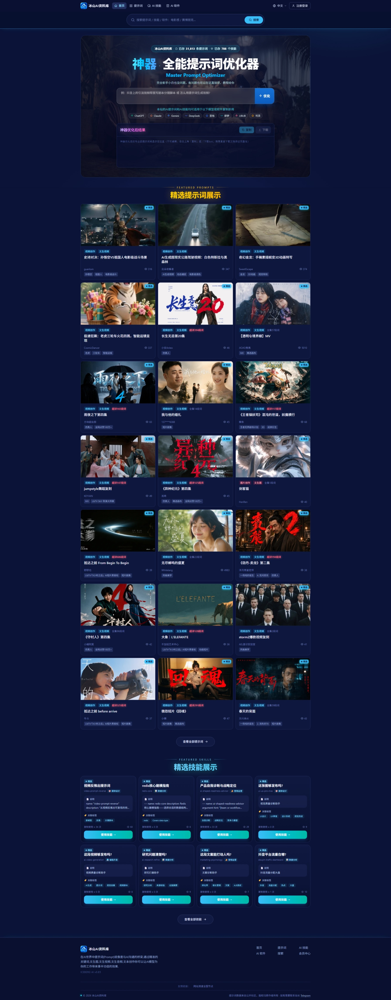

# ICEB AI LIBRARY · 冰山AI资料库

## 一、项目名称

**ICEB AI LIBRARY（冰山AI资料库）**

## 二、项目介绍

ICEB AI LIBRARY 是一个自建的 AI 提示词 / AI 技能 / AI 软件资料库网站，内置两万余条真实创作过程提示词与数百条 SKILL.md 技能文件，提示词按创作类型（文本 / 文生图 / 文生视频 / 文生音频）与分段结构组织，并配有与分段精确对应的实拍效果图、视频截图。

在资料库之外，站点还包含三层业务能力：

- **会员与积分体系**：积分充值、会员订阅、支付订单、积分流水、用量记录与生成资产转存。
- **OpenAI 兼容聚合网关**：`/v1/chat/completions`（SSE 流式）、`/v1/images/generations`、`/v1/embeddings`、`/v1/audio/*`、`/v1/videos`，支持多厂商多 Key 轮换、失败降级、按次计费与幂等结算。
- **实验场**：站内直接调用模型进行对话与图像 / 视频生成，任务状态与产物统一管理。

后台为独立管理员体系（RBAC 权限位 + 操作日志），覆盖内容、会员、支付、模型库、采集、站点设置等全部运营面。

## 三、项目展示

- 展示网址：<https://www.icebai.com>
- PC 端截图：



- 手机端截图：


- 后台截图：


## 四、项目特色

- **内容体系完整**：提示词 / AI 技能 / AI 软件三栏目，分类短码路由、标签体系、分段提示词与图文视频一一对应。
- **混合搜索**：提示词、技能、软件三索引一次查询合并，相关度与发布时间双排序，GitHub 风格整页搜索。
- **积分计费闭环**：整数积分预扣 / 结算 / 退补，同 requestId 幂等，失败自动对账补偿；模型库按厂商 → Key → 模型 → 端点四级管理，成本与毛利可核算。
- **聚合网关**：OpenAI 兼容协议（含 Anthropic / Gemini 协议转换），Key 密文存储与轮换、SSE 透传、熔断与失败换 Key 重试。
- **一键采集**：LibLib TV、即梦 AI、PromptHub 技能库 / 提示词库四个数据源，自动去重、图片与视频帧本地化。
- **后台全功能**：仪表盘、内容与评论管理、会员与订单、模型库与定价、支付渠道、运营告警、邮件模板、站点单页可视化编辑。
- **安全基线**：JWT 双密钥隔离会员与管理员、上传魔数校验、富文本白名单净化、站内重定向加固、AI 爬虫双层拦截、关键变量缺失时生产环境拒绝启动。
- **部署可控**：本地构建 + 原子替换上线，构建失败不影响线上；PM2 单实例托管，Nginx 反代。

## 五、项目开发技术架构

| 层 | 选型 |
|---|---|
| 前端 | Next.js 15（App Router / RSC）、React 19、Tailwind CSS 4、Tiptap 3 富文本 |
| 服务端 | Next.js Route Handlers（`/api/*` 站内接口、`/v1/*` 聚合网关）、Middleware 域名隔离 |
| 数据 | PostgreSQL 18 + Prisma 6 |
| 搜索 | Meilisearch 1.12（三索引，秒级增量同步守护进程） |
| 队列 | BullMQ + Redis（视频任务异步执行，可多实例消费） |
| 存储 | S3 / MinIO（预签名直链，SecretKey AES-256-GCM 加密存储） |
| 媒体 | sharp（图片 WebP 化）、ffmpeg（视频截帧取帧） |
| 鉴权 | jose JWT（会员 / 管理员双密钥、双 Cookie）、RBAC 权限位 |
| 邮件 | nodemailer + 可编辑模板（后台配置 SMTP） |
| 测试 | Vitest（单元 / 契约）、k6（压测基线） |
| 运行 | PM2（单实例 fork）+ Nginx 反向代理 |

## 六、项目支持环境

- **Node.js**：18.18 及以上（Next.js 15 要求），推荐 20 LTS
- **包管理**：npm（仓库含 `package-lock.json`）
- **数据库**：PostgreSQL 18（可用仓库 `docker-compose.yml` 启动）
- **搜索**：Meilisearch 1.12（可用 `docker-compose.yml` 启动，也可外接域名）
- **可选依赖**：
  - Redis 7+——配置 `REDIS_URL` 后启用 BullMQ 视频队列与多实例 worker
  - ffmpeg——采集与实验场视频截帧（Linux 建议 `apt install ffmpeg`，Windows 放入 PATH 或用 `FFMPEG_PATH` 指定）
- **生产运行**：Linux + PM2 + Nginx（HTTPS）
- **本地开发**：直接连本机 Windows PostgreSQL 服务（端口 5433、库 `icebaidata`），仓库不再自建/启动数据库实例

## 七、项目部署安装

### 7.1 本地开发

```bash
npm install                                 # 安装依赖（postinstall 自动 prisma generate）
cp .env.example .env                        # 按注释填写环境变量（本地 DATABASE_URL 指向 5433/icebaidata）
npm run db:push                             # 同步表结构到已启动的 Windows PG 服务（不自建实例）
node scripts/create-admin.mjs admin 用户名 密码   # 创建管理员（同时写入管理员表）
npm run dev                                 # http://localhost:3000（后台入口 /guanli-7k2m9x）
```

本地搜索需自行启动 Meilisearch，并与 `.env` 中 `MEILI_HOST` 对应：

```bash
bin\meilisearch.exe --db-path meili_data --http-addr 127.0.0.1:7700 --master-key dev-xxx
```

### 7.2 生产首次部署

```bash
# 1. 启动 PostgreSQL 与 Meilisearch（端口按 .env 中的 PG_PORT / MEILI_PORT）
docker compose up -d

# 2. 建库并恢复数据
docker exec -it prompthub-pg psql -U postgres -d postgres -c "CREATE DATABASE prompthub;"
pg_restore --host 127.0.0.1 --port 5432 --username postgres --dbname prompthub --no-owner database/prompthub-dump.dump

# 3. 配置 .env（数据库 / JWT / Meili / 站点域名，见第八节）
# 4. 安装依赖并构建，PM2 托管
npm install && npm run build
pm2 start ecosystem.config.cjs && pm2 save

# 5. Nginx 反代 127.0.0.1:3000 + SSL；Meilisearch 单独反代到 meili.域名.com
# 6. 数据库恢复后重建搜索索引并启动同步守护
node scripts/reindex-meili.mjs
pm2 start "npm run meili:sync" --name CompletePrompt-MeiliSync
```

媒体文件 `public/uploads/`（约 4GB）不在 git 内，需单独传输到服务器同路径，并修正属主：

```bash
scp -r public/uploads root@服务器:/www/wwwroot/CompletePrompt/public/
chown -R www:www public/uploads
```

### 7.3 日常发版（本地构建 + 原子替换）

服务器上不执行构建，避免与服务进程抢内存。流程为「本地打包上传 → 服务端解包替换」。

部署脚本不放在仓库内，统一存放于与仓库同级的 `bushu/` 目录（本仓库不提交任何部署脚本）：

```powershell
# 本地：构建 + 打包 + 上传（打包清单：.next（不含 cache）、src、prisma、scripts、public 与配置文件）
powershell -ExecutionPolicy Bypass -File E:\traexiangmu\提示词\bushu\deploy-pack-v099.ps1
# 只打包上传、不重新构建：加 -NoBuild
# 仓库不在默认位置时：加 -RepoRoot "D:\path\to\CompletePrompt"
```

脚本按自身所在目录推导仓库根（`bushu/` 的同级 `CompletePrompt/`），不依赖当前工作目录；仓库与 `bushu/` 不在同一父目录时用 `-RepoRoot` 指定。

```bash
# 服务器：解包到独立构建目录 → 依赖比对 → prisma generate → db push
#        → 原子上线 .next / node_modules → chown → pm2 重启 → 自检
bash /tmp/deploy-v099.sh
```

脚本的关键保证：产物先落在独立目录并校验 `.next/BUILD_ID`，校验通过才替换线上；构建失败线上完全不受影响；依赖变更时把新装的 `node_modules` 一并原子替换，避免 Prisma Client 版本落后导致字段查询报错。

## 八、项目需要改动的配置文件说明

所有业务配置集中在**仓库根目录 `.env`**（模板见 `.env.example`），代码中不写死域名、端口与密钥。

### 8.1 必须修改

| 键 | 用途 | 说明 |
|---|---|---|
| `DATABASE_URL` | 数据库连接串 | 本地指向 Windows PG 服务 `localhost:5433/icebaidata`；生产指向 Docker PG（端口以 `PG_PORT` 为准），建议带 `connection_limit` 与 `pool_timeout` |
| `JWT_SECRET` | 会员令牌签名密钥 | `openssl rand -hex 32` 生成；生产缺失会拒绝启动 |
| `JWT_ADMIN_SECRET` | 管理员令牌独立密钥 | 建议单独生成；缺省回退 `JWT_SECRET` 并告警 |
| `MEILI_HOST` / `MEILI_MASTER_KEY` | 搜索服务地址与主密钥 | 本地 `http://127.0.0.1:7700`，生产可走域名 |
| `NEXT_PUBLIC_SITE_URL` | 主站对外域名 | canonical、sitemap、分享链接、水印统一取值；**构建前必须设为目标域名** |
| `STORAGE_KEY_SECRET` | 存储桶 SecretKey 加密密钥 | AES-256-GCM；更换后需在后台重新填写各桶 SecretKey |

### 8.2 按需修改

| 键 | 用途 | 默认 / 说明 |
|---|---|---|
| `API_GATEWAY_BASE_URL` | API 网关域名 | 缺省取 `NEXT_PUBLIC_SITE_URL`；API 文档 Base URL 默认值 |
| `API_GATEWAY_HOSTS` | `/v1` 网关白名单域名 | 逗号分隔多线路；缺省取 `API_GATEWAY_BASE_URL` 的域名 |
| `JWT_USER_TTL_DAYS` / `JWT_ADMIN_TTL_DAYS` | 令牌有效期（天） | 30 / 7 |
| `DEEPSEEK_API_KEY` | 提示词优化器兜底密钥 | 后台「网站设置」配置优先 |
| `PORT` / `PM2_MAX_MEMORY` | 应用端口与 PM2 内存上限 | 3000 / 1G |
| `FFMPEG_PATH` | ffmpeg 可执行路径 | 缺省走 PATH |
| `REDIS_URL` | Redis 连接串 | 留空=不启用 BullMQ 队列 |
| `CRON_SECRET` | 定时任务接口鉴权 | 供 crontab 调用 `/api/cron/*` |
| `PLAYGROUND_MEDIA_STORAGE` | 实验场媒体存储 | `local`（默认）或 `s3` |
| `PLAYGROUND_SESSION_RETENTION_DAYS` / `PLAYGROUND_SKILL_WHITELIST` | 会话留存天数 / 技能白名单 | 0=不清理；空=不限制 |
| `VIDEO_TASK_POLL_MS` / `VIDEO_WORKER_CONCURRENCY` | 视频任务轮询间隔 / worker 并发 | 3000（最小 1000）/ 4 |

### 8.3 不通过 `.env` 配置的部分

- **框架配置**：`package.json`、`tsconfig.json`、`next.config.ts`、`postcss.config.mjs`、`vitest*.config.ts`、`next-env.d.ts` 属框架自身运行所需，保持原样。
- **后台业务参数**：注册开关、会员权益、积分包、支付渠道、SMTP、告警阈值、SEO 等存放在数据库 `SiteSetting` 等表中，由后台页面维护，**不要**写进 `.env`。
- **基础设施侧**：`ecosystem.config.cjs` 读取 `PORT` / `PM2_MAX_MEMORY`；`docker-compose.yml` 读取 `PG_PORT` / `MEILI_PORT`（数据库账号密码在 `.env.db`，Meili 主密钥在 `.env.meili`）。

## 九、项目目前版本

当前版本：**v1.0.0**（以 `package.json` 中的 `version` 为准）

## 十、项目更新计划

以下均为仓库中已记录但尚未完成的事项：

1. **实验场视频参考素材缩略图**：参考图/首帧素材在任务列表与历史记录中的缩略展示。
2. **模型价格表校准**：按厂商最新报价复核会员价与成本价（已有 `scripts/import-ark-pricing.mjs` 导入工具，默认 dry-run）。
3. **熔断统计口径修正**：客户端主动断连不应计入熔断失败窗口（见 `tests/k6/BASELINE.md` 已知 finding）。
4. **后台优化器使用记录 IP 规范化**：当前记录为 `::ffff:127.0.0.1`，需确认反代透传头配置并归一化为 IPv4。
5. **网关拆分评估**：按 `docs/adr/ADR-001-网关演进决策.md` 的触发条件（活跃 SSE 连接 > 200 等）决定是否拆出独立服务。

## 十一、联系方式

- 服务邮箱：support@icebai.com
- 官方 X：[@icebaicom](https://x.com/icebaicom)
